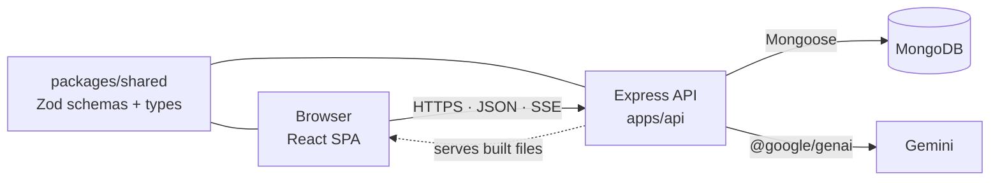
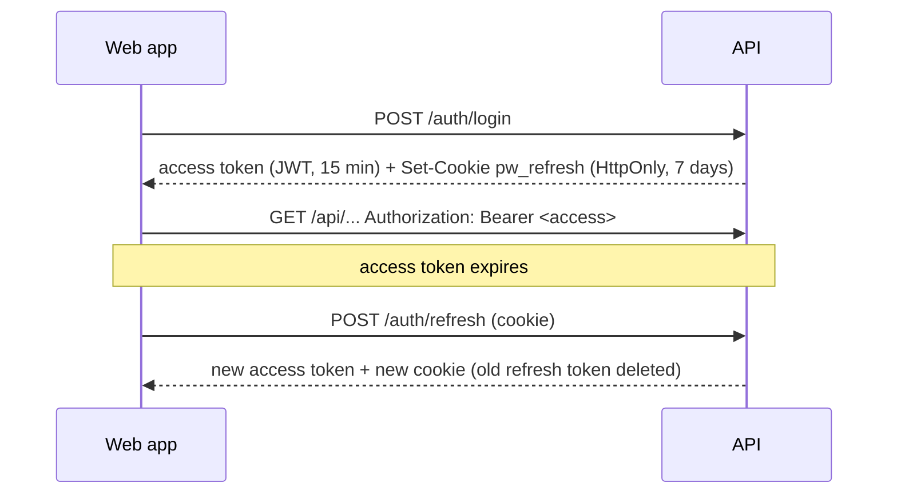
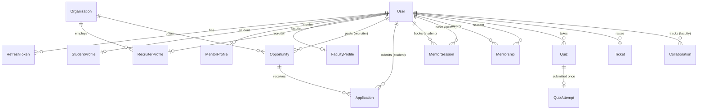

# Architecture

## Overview



One deployable unit: the API process also serves the compiled React app, so the browser talks to a single origin.
`packages/shared` holds the Zod schemas that validate requests on the server _and_ forms in the browser, so the two can't drift.

## Backend (`apps/api/src`)

```
app.ts                  builds the Express app (no side effects: tests import it)
server.ts               connects to MongoDB, builds indexes, listens, handles shutdown
config/env.ts           validates environment variables; refuses to start with missing or weak secrets
common/                 auth + role middleware, validation, error handling, rate limits, request log, static web hosting
models/                 Mongoose schemas
modules/<feature>/      routes → (controller) → service     auth · students · opportunities · applications · mentors
                                                           sessions · ai · helpdesk · recruiter · faculty · health
db/                     seed.ts (demo data) · createAdmin.ts (first admin)
```

Rules the code follows:

- **Routes** declare the path, the role guard and the Zod schema. **Services** hold the business rules. Only services touch models.
- Errors are thrown as `AppError` (or Zod errors) and turned into one JSON shape by a single error handler; unknown errors become a
  generic 500 and are logged, never leaked.
- Every state change goes through an explicit **transition table** (applications, sessions, collaborations), so illegal moves are 409s.
- "Not yours" and "doesn't exist" look the same (404), so identifiers can't be probed.
- **Concurrency**: where two requests could race (sign-up, apply, book, claim company, create mentee), the code checks first for a friendly
  message _and_ relies on a unique index as the real guarantee, translating a duplicate-key error into the same 409.

## Authentication



The access token lives only in memory (not `localStorage`), so XSS can't read a long-lived credential. The refresh token is opaque,
single-use and stored hashed; replaying an old one fails. Concurrent refreshes from the browser are collapsed into one request.

## Data model



Embed vs reference: a student's **skills** are embedded in the profile (always read together, never queried alone);
everything shared or unbounded (applications, sessions, tickets) is its own collection referencing users.
Jobs, internships and micro-internship gigs share one `Opportunity` collection with a `kind` field.

Important indexes: `User.email` (unique) · `Application(opportunity, student)` (unique) ·
`MentorSession(mentor, startsAt)` (unique, **partial**: only pending/confirmed, so cancelled slots free up) ·
`QuizAttempt(quiz, student)` (unique) · `RefreshToken.expiresAt` (TTL) · `Organization(name, type)` (unique).
The server builds indexes before it starts listening.

## AI module

```
routes ─► quiz / skillGap / advisor / helpdesk services ─► generateValidated() ─► AiProvider (interface)
                                                                                      └─ GeminiProvider (model fallback list)
```

- One `AiProvider` interface (`generateJson`, `generateText`, `streamText`); tests inject a scripted fake, and swapping vendor means
  writing one file.
- JSON output is parsed and validated with Zod, retried once, then a clean 502.
- User text is wrapped in delimiters and treated as data; system prompts forbid following instructions found inside it.
- The advisor streams via Server-Sent Events and aborts generation if the client disconnects.
- Quiz answer keys stay server-side until the quiz is submitted; each quiz can be submitted once.

## Frontend (`apps/web/src`)

`app/` (router, guards, layouts) · `features/<area>/` (pages and hooks per feature) · `components/` (shared UI) · `lib/` (API client, auth).
Routes are guarded per role. Server state is handled by TanStack Query; there is no mock data and no `localStorage` data store.

## Testing strategy

| Layer       | How                                                  | Proves                                                                            |
| ----------- | ---------------------------------------------------- | --------------------------------------------------------------------------------- |
| Route tests | real Express app + in-memory model fakes             | validation, permissions, state machines, AI flows, error handling, static hosting |
| Integration | same app + real MongoDB (`npm run test:integration`) | indexes and races, populate, `$elemMatch`, array updates                          |
| Smoke       | `scripts/smoke.mjs` against a running URL            | the deployment is wired correctly                                                 |
| CI          | lint · typecheck · tests · build · Docker build      | nothing broken reaches the main branch                                            |

## What changed from the original prototype

| Original                                                                            | Here                                                                                                   |
| ----------------------------------------------------------------------------------- | ------------------------------------------------------------------------------------------------------ |
| Three copies of the API (`server.js`, `api.js`, a dev server inside `vite.config`)  | one API                                                                                                |
| "Database" layer mixing in-memory data, a file ledger and Postgres                  | MongoDB only, behind services                                                                          |
| Hard-coded fallback JWT secret; most routes unauthenticated; auto-register on login | validated secrets (startup fails without them); auth + role guard on every route; no implicit accounts |
| ~250 KB of mock data and `localStorage` as storage in the UI                        | every screen backed by the API                                                                         |
| 50–97 KB single-file components, tab-string `if` chain                              | feature folders, small components, React Router                                                        |
| No validation, tests, CI or deployment story                                        | Zod on every input, 78 route tests + integration suite, CI, Docker, deploy guide                       |
